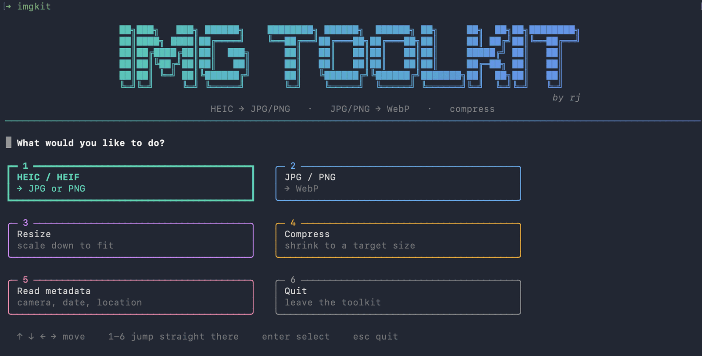
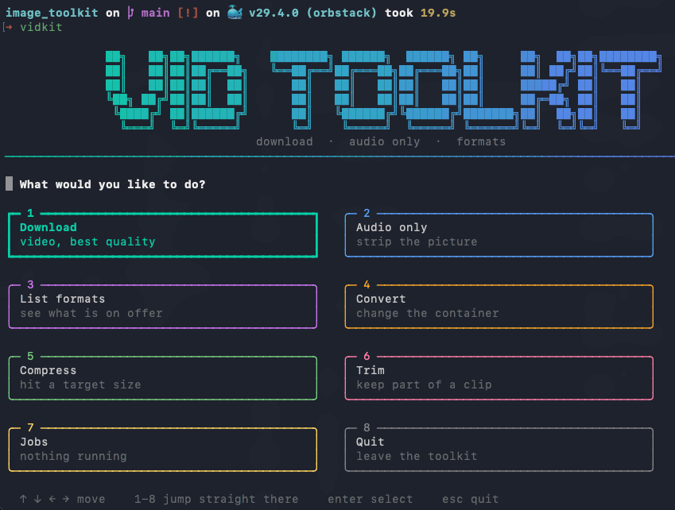

# media toolkit



`imgkit` for images, `vidkit` for video. Convert, resize, compress, strip,
inspect — all from the keyboard, all on your own machine, one install.

## imgkit — images

Six jobs:

- **HEIC / HEIF → JPG or PNG** — iPhone photos into something everything can open
- **JPG / PNG → WebP** — lossy or lossless, transparency preserved
- **Resize JPG / PNG** — scale down to fit a box or a percentage
- **Compress JPG / PNG** — shrink a file by a target percentage
- **Strip metadata** — remove it without re-encoding the picture
- **Read metadata** — see what a photo records about itself
- **SVG → PNG** — draw a vector at whatever size you need

No GUI, no flags to memorise. Run it, answer the prompts with the arrow keys.

## vidkit — video



Downloading, with [yt-dlp](https://github.com/yt-dlp/yt-dlp) doing the fetching:

- **Download a video** — best available, or capped at 1080p / 720p / 480p
- **Download the audio only**
- **List the available formats** — read-only, see what a link offers

Paste a link and it looks the video up first, showing the title, uploader and
length before anything is downloaded. A playlist link says how many videos it
holds and asks before starting.

### Audio downloads come out as webm

Sites commonly serve their best audio as **opus in a webm container**. It
plays fine, but it is not what most people expect an audio file to be, so
audio downloads offer to convert:

```
? Convert to MP3?                  Yes
? Keep the original file as well?  No
```

Conversion happens in the same pass as the download, not afterwards, so there
is one wait rather than two. Answering no to the second question deletes the
downloaded webm once the MP3 exists; answering yes leaves both side by side.

Both questions need ffmpeg. Without it the prompt is skipped and says so.

Tags and cover art are written either way. Without them a player shows an
unknown artist and a blank square, even though the information was there all
along: yt-dlp takes the artist from the uploader, the genre from the video's
own categories, and the album art from its thumbnail.

### It remembers where you save

The folder you choose is kept between runs, so you set it once rather than
every time. Downloads and locally converted files remember separately, in
`~/.config/rj-toolkit/settings.json`. A missing or damaged settings file costs
you that default and nothing else.

### Messy links are tidied

A YouTube link carrying `list=RD…` is a radio mix — an endless generated
playlist that would otherwise download forever. When a link names a specific
video, the playlist and share-tracking parameters are dropped:

```
watch?v=9cwf3BGhqFA&list=RD9cwf3BGhqFA&start_radio=1   ->   watch?v=9cwf3BGhqFA
```

A genuine `playlist?list=…` link is left alone, since there the playlist is
what was asked for.

### Working on files you already have

vidkit also handles video already on your machine:

- **Convert** — mp4 / mkv / mov / webm. When the streams inside are already
  legal in the target container it repackages rather than re-encodes: under a
  tenth of a second, and the video is untouched. It says which it is about to
  do before starting.

  Give it a folder instead of a file and every video in it is converted to
  the one format you pick, as a single job with one progress bar. Answer yes
  to "include subfolders?" and the tree is mirrored into the output folder,
  so `trip/day1/clip.mov` becomes `converted/trip/day1/clip.mp4`. Before
  anything starts it lists the files it is leaving alone and why: already in
  that format, already converted by an earlier run, or unreadable. The
  output folder is never scanned, so running it twice converts nothing
  twice. If some of the videos would not play on a Mac once copied across,
  it asks once whether to re-encode them, and only those are re-encoded.
- **Compress to a target size** — name a size and it works the bitrate out
  from the duration. This one deliberately uses software encoding: Apple's
  hardware encoder is faster but honours a bitrate target loosely, producing
  1.9 MB when asked for 1 MB where libx264 produced 995 KB.
- **Trim** — a fast cut copies the streams, so it is instant and lossless but
  must begin at a keyframe. On a video with widely spaced keyframes that can
  make a five second cut come out at ten, so the tool measures what it
  actually produced and tells you, rather than repeating what you asked for.
  Turn the fast cut off for an exact one.

### ffmpeg

Most sites serve anything above about 720p as **separate video and audio
streams**, which have to be merged back together. That merging is ffmpeg's
job. Without it, only already-combined formats can be taken:

```
brew install ffmpeg
```

The toolkit checks at startup and says so rather than failing midway: with no
ffmpeg it asks only for pre-muxed formats, so the download still completes —
just at a lower ceiling. Audio-only downloads prefer `m4a` for the same
reason, since that needs no conversion.

Download what you have the right to download.

### When a download stops working

Sites change how they serve video, and yt-dlp catches up within days. A copy
that worked last month can start failing on the same link, usually as a 403,
an "unable to extract" error, or a site that simply stops being recognised.

Updating yt-dlp is the fix, and it is separate from updating this toolkit:

```bash
.venv/bin/pip install -U yt-dlp
```

Run it from the repo folder. It only touches the toolkit's own virtualenv, so
nothing system-wide changes and no other project is affected.

Worth reaching for when:

- a **403** keeps coming back after retrying
- the error mentions **"unable to extract"** or a player response
- a site that used to work stops being recognised at all
- you are downloading from somewhere niche, where extractors break most often

If the retry prompt sees a 403, it suggests this command on the spot. The
error not going away after an update usually means the video really is walled
or gone rather than that something is broken.

## Install

```bash
git clone https://github.com/yourjhay/media-toolkit.git
cd media-toolkit
./setup.sh
```

Already have a copy? Just `cd` into it and run `./setup.sh`.

This creates a self-contained `.venv/` inside the folder, shared by both
tools. Nothing is installed system-wide, and `setup.sh` is safe to re-run.

It then offers to put `imgkit` and `vidkit` on your PATH, by symlinking them
into `~/.local/bin` — no `sudo`, and it tells you if that folder is not on your
PATH yet. If something else already owns either name, it says so and leaves it
alone rather than replacing it.

```bash
./setup.sh --link                   # link without being asked
./setup.sh --no-link                # skip it without being asked
./setup.sh --bin-dir /usr/local/bin # somewhere else
./setup.sh --link-only              # already set up; just link
```

Piped into a shell or run in CI there is nobody to answer the prompt, so it
does not link and does not hang — it says to re-run with `--link`.

ffmpeg is the one optional extra. imgkit never needs it; vidkit needs it to
merge high-quality streams, convert audio to MP3, and do anything with local
video files:

```bash
brew install ffmpeg
```

## Run

```bash
./imgkit     # images
./vidkit     # video
```

Or, if you did not let `setup.sh` link them:

```bash
./setup.sh --link-only
```

## How the compressor works

You give it a percentage — "make these 60% smaller" — not a quality number.

For **JPEG** it binary-searches the encoder quality scale (95 down to 20) and
keeps the *highest* quality whose output still fits under your target. That is
about seven encodes instead of seventy-five.

For **PNG**, which is lossless and has no quality dial, the only lever is
colour count. It tries full colour first, then palettes of 256, 128, 64, 32,
16 and 8 colours, and stops at the first one that fits.

If your target simply cannot be reached — asking an already-squeezed thumbnail
to lose another 95% — it still writes the best result it managed, but reports
the file as **short of target** and tells you what it actually achieved. It
will not claim it hit a number it missed. Output is never larger than the
input; if re-encoding would inflate a file, the original bytes are copied
instead.

## The menu

Operations are cards in a grid, two per row, each in its own colour:

```
┏━ 1 ━━━━━━━━━━━━━━━━━━━━┓   ╭─ 2 ────────────────────╮
┃ HEIC / HEIF            ┃   │ JPG / PNG              │
┃ → JPG or PNG           ┃   │ → WebP                 │
┗━━━━━━━━━━━━━━━━━━━━━━━━┛   ╰────────────────────────╯

╭─ 3 ────────────────────╮   ╭─ 4 ────────────────────╮
│ Compress               │   │ Quit                   │
│ shrink to a target size│   │ leave the toolkit      │
╰────────────────────────╯   ╰────────────────────────╯
```

Arrow keys move, `1`-`4` jump straight to a card and run it, enter selects,
escape quits. The selected card is drawn with a heavy border as well as a
brighter colour, so the selection is still visible over SSH, in a pipe, or in
any terminal without truecolour. Below about 55 columns the grid drops to a
single column.

## SVG → PNG

A vector has no size of its own in pixels, so the question is how large to
draw it:

```
? Render at:
  › 2× its own size   320 × 200   (crisp on a retina screen)
    Its own size      160 × 100
    3× its own size   480 × 300
    An exact width

? Background:
  › Transparent
    White
    Black
```

Two times is the default because a logo drawn at its nominal size looks soft
on any modern display, and a vector costs nothing to draw larger. When one
file is selected the sizes are worked out and shown, so the choice is concrete
rather than arithmetic you do in your head.

The size is taken from the file's `width` and `height`, falling back to its
`viewBox` when those are missing or given as percentages. Units are handled —
`72pt` is 96 pixels, not 72.

A drawing declaring none of the three has no aspect ratio at all. An exact
width then renders it square and the result says so; a scale is refused
outright, because there is nothing to multiply and quietly inventing a size
would be worse than saying no.

Rendering is done by [CairoSVG](https://cairosvg.org). It handles ordinary
drawings — logos, icons, diagrams — well, and is weaker on advanced filters
and unusual text. `setup.sh` installs it; no Homebrew package is needed.

## Strip metadata

Removes metadata **without touching the picture**. Not "almost the same" —
byte-for-byte identical pixels:

```
source              1.3 MB   GPS=4   camera=iPhone 15 Pro
strip everything    1.3 MB   GPS=0   camera=—              pixels identical: True
strip location      1.3 MB   GPS=0   camera=iPhone 15 Pro  pixels identical: True

via compress -10%   1.1 MB   GPS=0                         pixels identical: False
```

The other operations all decode the image and encode it again, which costs a
generation of quality every time. Metadata does not live in the pixels, so it
can be cut out of the container directly: the compressed image data is copied
through untouched and only the metadata blocks are dropped or rewritten. JPEG
APP segments, PNG chunks and WebP RIFF chunks are each handled natively.

Two modes: remove everything, or remove only the location and keep the camera
and date.

**Colour profiles are deliberately kept.** An ICC profile is metadata in the
technical sense, but dropping one visibly shifts the colours, which is not
what anyone means by "strip metadata".

XMP blocks are always removed rather than edited, in both modes, because XMP
can carry its own copy of the location. HEIC is not supported here — its
container is not one this handles — so convert it first.

## Read metadata

Point it at a photo and it shows what the file carries:

```
╭─ IMG_9001.jpg ──────────────────────────────────────────────╮
│   Size        1.8 MB                                        │
│   Image       4032 × 3024   JPEG   RGB                      │
│                                                             │
│   Camera      Apple iPhone 15 Pro                           │
│   Lens        iPhone 15 Pro back camera 6.86mm f/1.78       │
│   Exposure    1/120s   f/1.78   ISO 64   24mm               │
│   Taken       2026-09-21 14:32                              │
│   Software    17.5.1                                        │
│   Location    14°35'30"N, 121°00'00"E                       │
╰─────────────────────────────────────────────────────────────╯
  This photo records where it was taken.
  https://www.google.com/maps?q=14.591667,121.0
```

Location and serial number are highlighted, because those are the two fields
that identify you rather than the picture. The map link is a terminal
hyperlink, so it opens on a click in terminals that support that.

Point it at a folder instead and you get one row per file, with a count of how
many record a location, then the option to open any of them in full:

```
  File              Size     Pixels   Camera                Taken              Location
  IMG_9001.jpg   64.1 KB   1200×900   Apple iPhone 15 Pro   2026-09-21 14:32   yes
  chart.png      16.3 KB    800×600   —                     —                  no
  plain.jpg      19.5 KB    640×480   —                     —                  no

  1 of 3 record where they were taken.
```

This one only reads. It never asks for an output folder, never asks about
overwriting, and writes nothing.

## Your photos know where you live

Phones write GPS coordinates into every picture. Converting a photo and posting
it can publish the place it was taken, which for a photo shot at home is your
home address.

Every operation asks what to do with that record:

| Choice | Camera, lens, date | Location |
|---|---|---|
| Keep camera and date, drop location *(default)* | kept | **removed** |
| Strip everything | removed | **removed** |
| Keep everything | kept | kept |

The default drops location, because publishing it should take a deliberate
choice rather than an oversight. The orientation tag is always removed, in
every mode — the rotation has already been applied to the pixels, so leaving
the tag would rotate the image a second time.

## Resize

Pick a preset box (1920, 1200 or 800), a percentage, or your own maximum width
and height. The aspect ratio is always preserved and the image is **never
enlarged** — asking for 200% of an 800px photo gives you the 800px photo back,
because enlarging only invents detail that was never captured.

Quality is fixed at 92, deliberately high: downscaling has already discarded
detail and there is no sense throwing away more in the same pass. Run the
compressor afterwards when you want to trade quality for size on purpose.

Before you confirm, the preview measures one real file at your chosen
dimensions and shows the estimated total.

## Bulk

Point it at a folder instead of a file and it works on everything inside:

- The extension filter follows the operation — HEIC mode only picks up
  `.heic` and `.heif`, WebP and compress modes only `.jpg`, `.jpeg` and `.png`.
- Answer yes to "include subfolders?" and it walks the whole tree.
- One progress bar, one summary, one total.
- A corrupt file is logged as failed and the batch keeps going.
- The output folder is excluded from the scan, so a re-run does not eat its
  own results.

A recursive run flattens the tree into one output folder, so two files with
the same name in different subfolders would want the same output. The first
one claims the name and later ones are numbered:

```
src/a/photo.jpg  ->  out/photo.webp
src/b/photo.jpg  ->  out/photo-2.webp
```

The preview lists every rename before you confirm. Comparison is
case-insensitive, because macOS treats `Photo.webp` and `photo.webp` as one
file. A source genuinely named `photo-2.jpg` claims `photo-2.webp` for itself
and the collision skips past to `photo-3.webp`.

Two things bulk does not do: it runs sequentially, so two hundred photos take
two hundred times one photo; and there is no filename pattern filter, so it is
every matching image in the folder or none.

## It tells you the size before you commit

Pick a source and you get a box describing it — name, size, dimensions,
format, location; or for a folder, how many matching images sit at the top
level and how many are nested below, which is the information you need to
answer the "include subfolders?" question sensibly.

Then, as you type a quality or a percentage, the estimated output size appears
beside the prompt and updates on every keystroke:

```
? JPEG quality (1-100): 90        ≈ 2.4 MB  (from 1.8 MB, +44%)
? Shrink files by what percent? (1-99): 60        ≈ 735 KB  (from 1.8 MB, -60%)
```

For the compressor this is exact — the target *is* the arithmetic.

For a quality setting there is no formula, because output size depends on the
picture. So one real file is encoded at eight quality anchors when you reach
the prompt (about 1.3 seconds for a 12MP photo, shown with a spinner) and
everything between them is interpolated. Measured against the actual encoder
on a 12MP iPhone photo, that lands within about 4% across most of the scale
and exactly on the default of 90. It drifts to roughly 11% at quality 97,
where the curve is steepest — hence the `≈`.

For a folder, the median-sized file is the one sampled and the result is
scaled to the batch, which the prompt says out loud. Median rather than first
or largest, so one panorama among a hundred snapshots does not set the
expectation for all of them.

## HEIC → JPG usually makes the file *bigger*

This is not a bug. HEIC compresses far better than JPEG, so a 1.8 MB iPhone
HEIC re-encoded at JPEG quality 90 lands around 2.4 MB. You are trading size
for compatibility. The summary says **Size increase** rather than pretending
it saved you anything.

If you want compatibility *and* a smaller file, convert to WebP instead, or
run the compressor over the JPEGs afterwards. Dropping the JPEG quality to
around 75 also brings it back under the original.

## Paths you can paste

The path prompts accept whatever your terminal gives you: tab completion's
trailing space, a quoted path, or a file dragged into the window with its
spaces backslash-escaped. All three are cleaned up before use.

## Things it will not do to your files

- **Originals are never modified.** Output always goes to a separate folder,
  `converted/` beside the source by default.
- **Existing output is not overwritten** unless you say yes at the prompt.
- **Compressing a file over itself is refused outright**, even if you point the
  output at the source folder.
- **A corrupt file does not kill the run.** It is recorded as failed and the
  batch carries on.

## A note on rotation

iPhone HEIC files are stored unrotated, with the rotation recorded in an EXIF
tag. Anything that reads the pixels without honouring that tag shows the photo
sideways. Every operation here bakes the rotation into the pixels and clears
the now-misleading tag, so a 1200×900 landscape-stored portrait comes out as a
genuine 900×1200 file.

## Layout

```
imgkit / vidkit     launchers
setup.sh            creates .venv, installs dependencies
shared/
  banner.py         the block-letter title, in two fonts
  chrome.py         banner rendering and the card menu
  menu.py           card grid geometry
  prompts.py        asking questions
  format.py         bytes and durations as people read them
  paths.py          cleaning up a typed path
image_toolkit/
  core.py           the image operations — pure functions over paths
  discovery.py      finding the files to work on
  jobs.py           running one operation across many files
  stripper.py       metadata removal without re-encoding
  planning.py       turning choices into a bound operation
  tui.py            the prompts and the rendering
video_toolkit/
  download.py       yt-dlp, with the library injectable for tests
  formats.py        what to ask for, and how to describe what is offered
  urls.py           cleaning up a pasted link
  planning.py       the menu
  tui.py            the prompts and the rendering
tests/
```

`shared` knows about neither toolkit, and the two toolkits know nothing about
each other — tests assert both. Within each, the domain modules know nothing
about the TUI, so a flag-driven CLI could be added without touching them.

## Tests

```bash
.venv/bin/python -m pytest
```

The tests generate real JPEG, PNG and HEIC files and run the real encoders —
nothing about the image pipeline is mocked.
